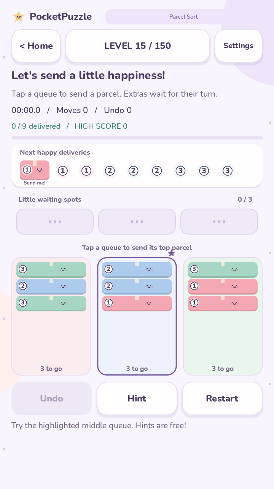
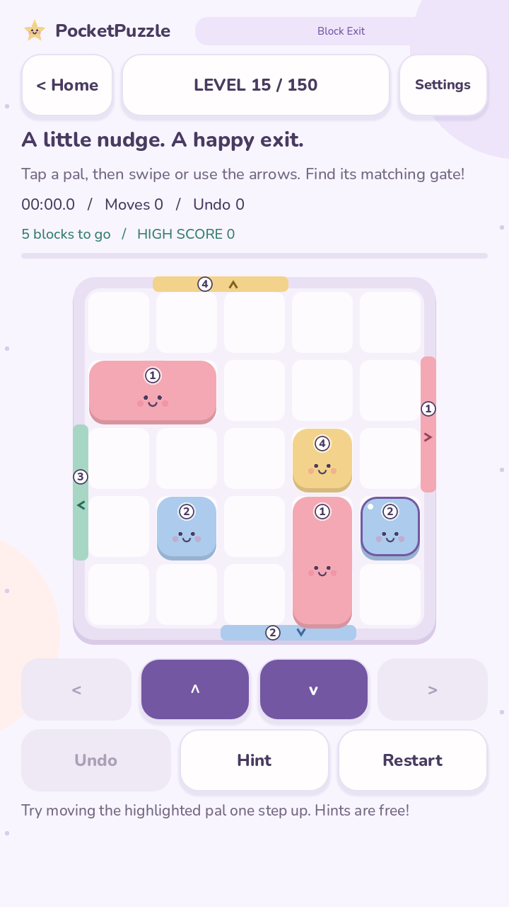
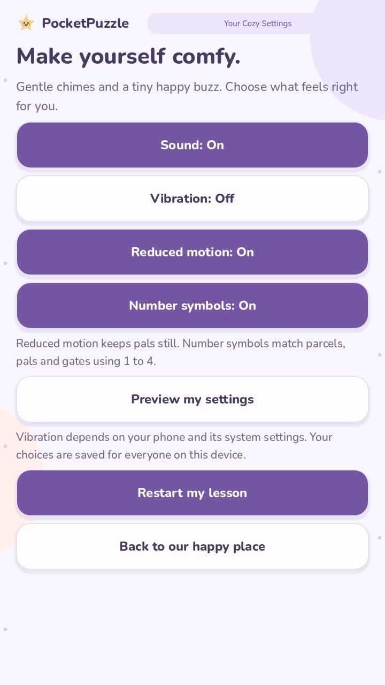

# Comfort and hints — build 0.6.0

Open Settings on the home screen or in a puzzle:

- **Reduced motion** removes parcel nudges, block flashes, and victory bouncing.
  Completed puzzles advance directly to the result. Sounds and vibration retain
  their separate controls.
- **Number symbols** replaces shape badges with dark numerals on white badges.
  Matching parcel types, blocks and gates use the same number from 1 to 4.
  Colors remain as another cue. Numbers indicate type, not delivery order.

Both options default off and persist for everyone using the device. Existing
scores, players, daily results and unfinished attempts are retained. Returning
from Settings resumes the same attempt with the selected preferences.

## A little help

The **Hint** button is available in regular and daily puzzles. It highlights a
queue or selects a block and describes a single direction. It does not apply a
move, reset the timer, or add to the move/undo counters. There is no cost, ad,
quota, or score penalty for asking. Actual moves and undo keep their usual scoring.
Local rankings include solves made with hints.

Hints replay the catalogue's verified solution in separate rules, comparing its
board states with the current board. If the current state is on that route, the
next legal action is shown. If it is elsewhere, the hint suggests how many undo
steps return to a known route. A different route may also be solvable; this is
guidance toward one verified solution, not a shortest-path solver. Undo is always
the player's choice and retains its normal scoring penalty.

Successful moves and undo clear stale hints. Lessons already have step-by-step
guides, so their Hint button is disabled. Hint computations have a bounded
2,000-step catalogue limit and do not search an unbounded game tree.

## Validation

Run from PocketPuzzle: `godot --headless --path . --script tests/comfort.gd`.
The suite checks start and midway hints for all 300 levels, legal suggestions,
unchanged live rules, backtracking, migration, persisted preferences, daily and
regular hint UI, retained counters, and disabled animations.

Check numeral readability, button reachability and touch behavior on intended
phones. These custom-drawn game boards are not a claim of full screen-reader
support. Android's [accessibility guidance](https://developer.android.com/guide/topics/ui/accessibility/apps)
also recommends testing the interface with users and accessibility tools.

Windows and Linux checks pass with Godot 4.7.2. The exported APK was installed on
an OPPO CPH1803 (Android 8.1): settings persisted through force-stop, normal resume
kept its counters, both hint buttons worked, and existing scores were preserved.
GPU previews were inspected at 720 × 1280; game controls fit without scrolling.

