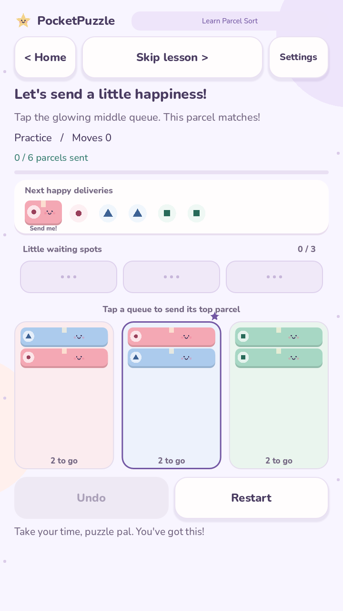
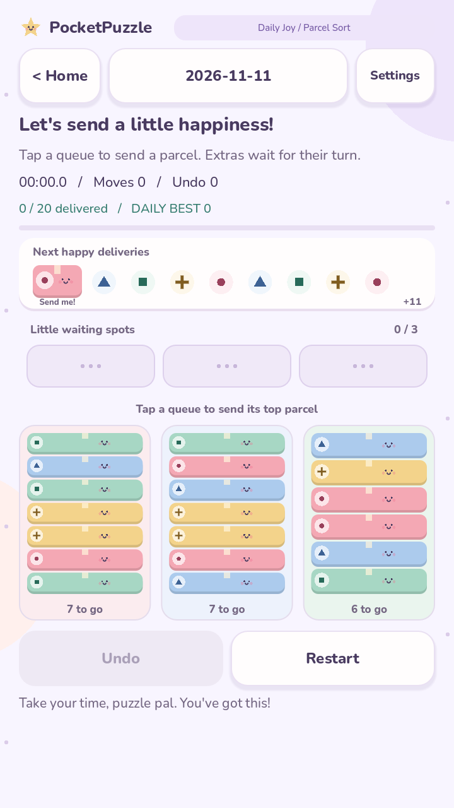

# Daily Joy — build 0.5.0

## A little reason to come back

The home screen offers one Parcel Sort puzzle and one Block Exit puzzle for the
device's current local date. The selection is deterministic and shared by devices
using the same date and catalogue. It chooses from the existing 150 puzzles per
game. No server, login, internet connection, or notification permission is needed.

Daily personal bests are stored separately for each local player and date. Replays
can improve the high score, fastest time, and fewest moves. They do not add regular
ranking points or completion stars. The newest 90 dates are retained. The home
screen updates when the date changes. Changing the device clock changes its daily
selection; these are friendly offline personal records.

A daily attempt already in progress belongs to the date it started. Opening a
new day's daily puzzle replaces an unfinished older daily attempt for that game.
Regular unfinished puzzles remain separate.

## Learn with the pals

Use **Learn** on either game card. New players also receive a lesson when first
opening a regular game. Existing players' progress and scores are retained.

- Parcel Sort guides a matching delivery, parks an unmatched parcel in a waiting
  spot, and demonstrates automatic delivery when its turn arrives.
- Block Exit highlights the first pal and guides slides toward its matching gate.
- Only the guided move advances the lesson. Other input gives a gentle reminder.
- Lessons can be skipped or repeated. They are practice, without scores or stars.

## Gentle feedback

Settings is available on the home screen and while playing. Sound is on by default;
vibration is off by default. Both preferences are stored for the whole device.
**Preview my settings** respects mute and vibration choices. Returning from
settings resumes a regular/daily attempt; a practice lesson restarts.

Move, delivery, undo, and win chimes are short, quiet PCM sounds generated in
GDScript. There is no background music loop or downloaded audio. Android exports
request only the normal VIBRATE permission for haptic feedback; Internet remains
disabled. Vibration depends on device hardware and system settings. Audible volume
also depends on the phone's media-volume setting.

## Pick up where you left off

Each player can retain one unfinished regular attempt and one unfinished daily
attempt for each game. The **Resume** button on a regular game card restores it;
the daily button resumes today's pending daily attempt.

The save contains the legal move path, elapsed active time, counters, and selected
block. Replaying the path on load reconstructs the board and undo history and
rejects malformed or incompatible sessions. Successful moves, undo, navigation,
backgrounding, and periodic five-second checkpoints save the attempt. Restart
resets that attempt. Selecting another regular level replaces its pending regular
attempt. Lessons are restarted rather than saved mid-step.

Saves use a flushed temporary file and retain one previous valid backup. An
interrupted primary write can fall back to that backup. Uninstalling or clearing
app storage removes local data. Old completion and score saves migrate without
inventing historical results. Completing a puzzle saves its result immediately
and removes its pending attempt before the victory animation.

## Checks

Run from PocketPuzzle:

    godot --headless --path . --script tests/smoke.gd
    godot --headless --path . --script tests/gameplay.gd
    godot --headless --path . --script tests/records.gd
    godot --headless --path . --script tests/daily_joy.gd

The Daily Joy suite covers guided lessons, stable daily selection, independent
records, date rollover, settings persistence, full reload with undo, corrupt saves,
backup recovery, PCM sample bounds, and leaving during the win animation.

Validated on Windows and Linux with Godot 4.7.2, and exported and installed on an
OPPO CPH1803 running Android 8.1. Device checks covered normal and daily resume
after force-stop, retained undo history, sound preference persistence, lesson
completion, and preservation of existing scores and progress. Headless tests do
not establish audio quality or device performance; check audible volume and
optional vibration on the intended phone.

