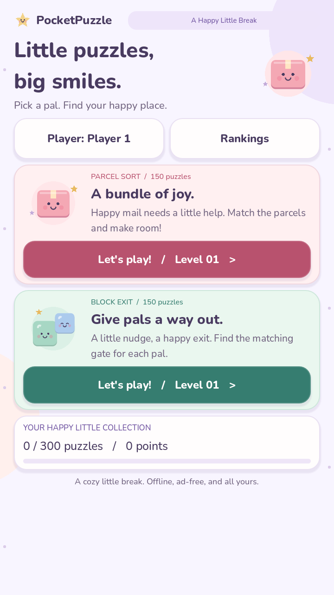
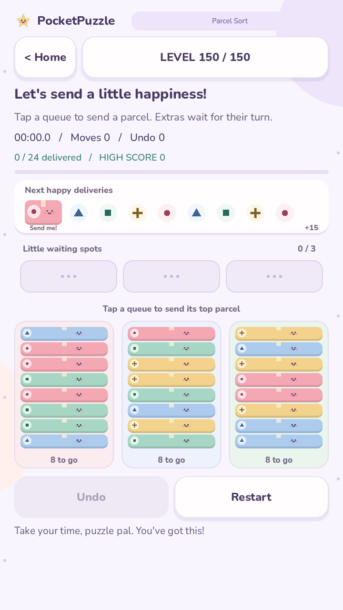
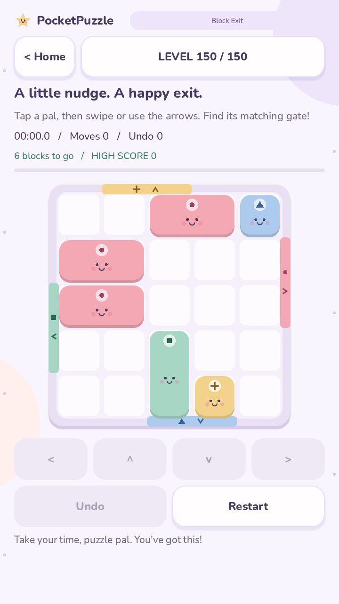

# Friendly interface, build 0.4.0

A cozy pastel interface for both puzzle games, with matching local player and
ranking screens. All 300 levels, timing, scoring, and existing saves are retained.

## Preview

| Parcel Sort | Block Exit |
| --- | --- |
|  |  |

These are actual Godot GPU captures at 720 x 1280. The screenshots use an isolated
capture save, not the player's progress.

## Visual system

- Lavender background with soft decorative shapes; blush, blue, mint, and yellow
  puzzle pieces. Deep plum text and stronger action colors keep controls readable.
- Rounded Nunito lettering, soft borders and shadows, pill headers, and friendly
  instructions throughout the collection, games, chooser, results, and rankings.
- Parcel and block characters have eyes, cheeks, and smiles. Their original type
  symbols remain visible, so matching does not rely on color alone.
- Completed levels receive a star badge. Selected blocks keep a strong plum outline.
- Move feedback lasts about a third of a second. The victory mascot animation ends
  after 1.3 seconds. Background and menu illustrations are static.
- The app icon and boot splash use the same parcel mascot.

## Editing

`ui/friendly_theme.gd` owns the shared palette, rounded typography, and panel styles.
`ui/playful_art.gd` draws the mascot illustrations directly in Godot.
`ui/puzzle_board.gd` draws the playable pals and their identifying symbols.
The drawings require no physics, external image service, or particle system.

Nunito is bundled from the Google Fonts Nunito family. Its copyright notice and
SIL Open Font License are in `assets/fonts/OFL.txt`, also included in Android exports.
The font loads offline on both desktop and Android.

Edit `icon.svg` for the app mascot, then regenerate the boot image from PocketPuzzle:

    godot --headless --path . --script tools/bake_splash.gd

Capture the interface with:

    godot --path . --script tests/capture.gd

Images are saved in ignored `builds/`. Refresh the checked-in preview images from
those captures after visual changes. Standard import, smoke, gameplay, and records
checks are described in the repository README.

## Validation

Windows and Linux smoke, gameplay, and record checks passed, including all 300
level solutions and the full chooser page after a completed level. GPU captures
confirmed that both games and their controls fit the 720 x 1280 viewport.

The Android APK includes Nunito, its license, and the custom boot splash. On an
OPPO CPH1803, the update retained the existing completed levels and scores. Touch
input completed Parcel Sort level 1 in six moves and Block Exit level 1 in seven
moves, including a swipe. Both result screens showed the new mascot celebration
and saved score records. Captured app logs contained no errors.
