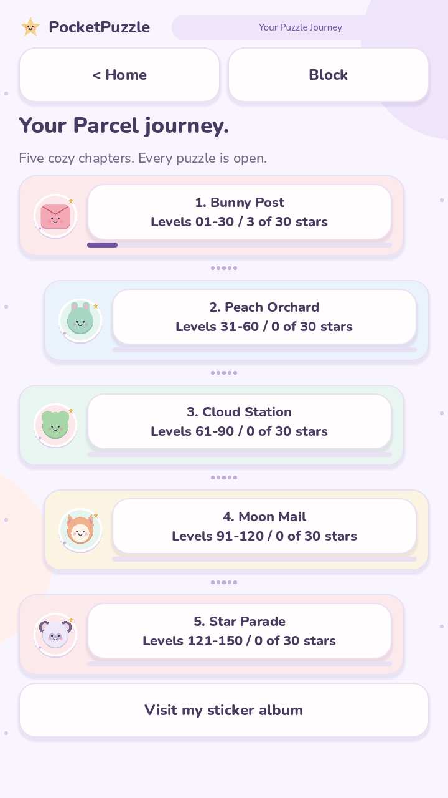
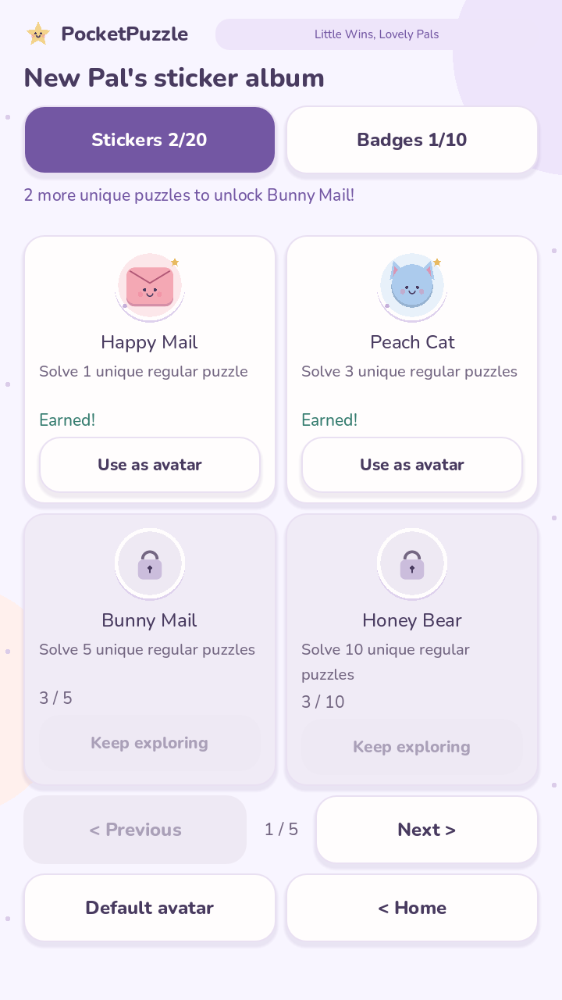
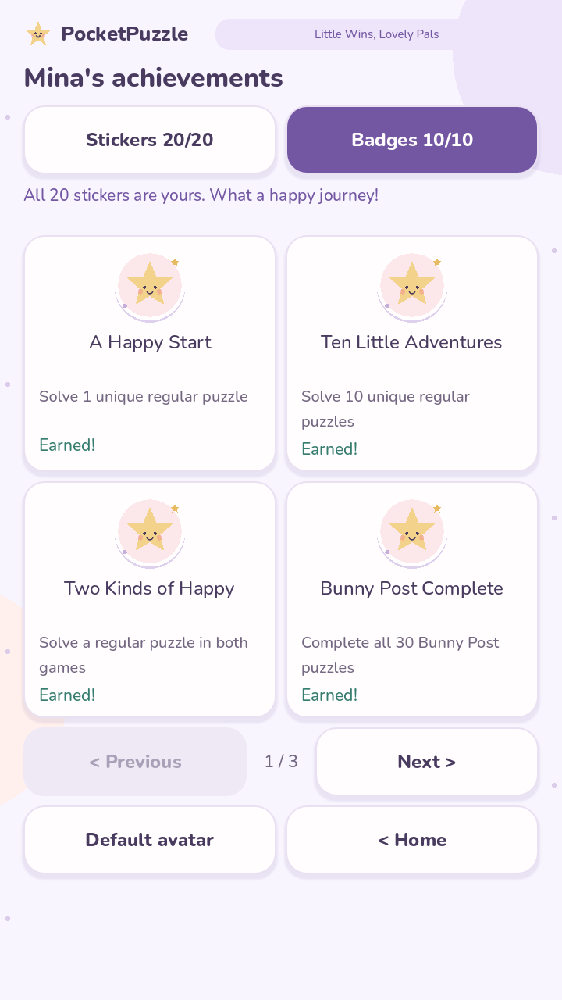

# Puzzle Journey & Sticker Collection — build 0.7.0

## Visit a cozy chapter

Tap **Map** on either game card, the level button while playing, or **Journey
maps** in the home collection panel. Each game has five chapters of 30 puzzles.
The chapter cards show unique completion stars and a progress bar. Tap a card to
open its 30-level chooser. All levels remain open, including later chapters.

| Levels | Parcel Sort | Block Exit |
| --- | --- | --- |
| 1–30 | Bunny Post | Meadow Pals |
| 31–60 | Peach Orchard | Bubble Bay |
| 61–90 | Cloud Station | Honey Garden |
| 91–120 | Moon Mail | Moon Blocks |
| 121–150 | Star Parade | Rainbow Ridge |

## Meet the sticker pals

Open **Sticker album** from the home collection, a journey map, or Players.
There are five pages of four stickers. Each tile shows its requirement and
progress; locked avatars cannot be selected. Rewards unlock automatically without
a claim, currency, ad, purchase, or internet connection. The home collection and
album show the next unearned sticker goal, such as “2 more unique puzzles to
unlock Bunny Mail!”

| Unique regular puzzles, across both games | Sticker |
| --- | --- |
| 1 | Happy Mail |
| 3 | Peach Cat |
| 5 | Bunny Mail |
| 10 | Honey Bear |
| 20 | Pond Frog |
| 40 | Cloud Pup |
| 75 | Cozy Fox |
| 100 | Moon Owl |
| 200 | Star Panda |
| 300 | Rainbow Unicorn |

| Unique puzzles in one game | Parcel Sort sticker | Block Exit sticker |
| --- | --- | --- |
| 10 | Post Duck | Meadow Turtle |
| 30 | Peach Bird | Bubble Fish |
| 75 | Cloud Koala | Honey Bee |
| 150 | Mail Penguin | Rainbow Butterfly |

Finish a daily puzzle on one date to earn **Sun Chick**, and on seven different
dates to earn **Night Bat**. Both daily games on one date count as one day.
Dates do not need to be consecutive. Replays improve daily bests but do not add
another reward day. Device-local dates are used, as in Daily Joy.

## Celebrate little achievements

The album's **Badges** tab has ten local achievements:

| Badge | Requirement |
| --- | --- |
| A Happy Start | First unique regular puzzle |
| Ten Little Adventures | 10 unique regular puzzles |
| Two Kinds of Happy | A regular puzzle in each game |
| Bunny Post Complete | All Parcel levels 1–30 |
| Meadow Pals Complete | All Block levels 1–30 |
| Today's Little Win | A daily puzzle on one date |
| Three Happy Days | Daily puzzles on three different dates |
| A Week of Wonder | Daily puzzles on seven different dates |
| Thirty Days of Joy | Daily puzzles on 30 different dates |
| The Whole Happy Journey | All 300 unique regular puzzles |

The winning move credits rewards immediately, before any celebration. A result
shows newly earned treasures and links to their album page. Replaying a completed
puzzle does not show the same unlock again. Lessons are unranked practice and do
not earn stickers or badges. Hints and comfort preferences do not block rewards.

## Make a pal your own

Choose **Use as avatar** beneath an earned sticker. It appears on your home
welcome, in Players, and beside your local ranking. **Default avatar** returns
to the original pal. Selection is saved for that player; switching players
restores their own avatar, stickers, badges, records and unfinished games.
Cosmetic rewards do not change scores, timer rules, difficulty or ranking order.

## Existing saves and bounded history

Save version 4 retains existing players, settings, scores and pending sessions.
Normal rewards use the union of valid completion flags and scored levels, so
older completion-only saves receive credit without invented historical scores.
The same level in both sources counts once. Reward lists are derived from these
unique completions, so no repeated claims or reward currency need to be saved.

Daily reward credit has a separate, validated ledger of up to 30 unique dates.
This is enough for every daily milestone and survives the daily-results
90-date cleanup. Migration credits available retained daily records. Dates already
removed by an earlier build cannot be reconstructed. Offline local dates are
friendly personal milestones, without server verification or anti-cheat.

Twenty static vector illustrations use the existing palette and face helpers.
No new dependencies, large image assets, particle systems, accounts, ads,
analytics, or permissions were added.

## Validation

Run from PocketPuzzle:

    godot --headless --path . --script tests/journey.gd

The suite checks all reward thresholds, replay deduplication, chapter ranges,
daily history retention, malformed saves, legacy credit, avatar eligibility,
profile isolation, all album pages and win-time reward notifications. Run the
existing smoke, gameplay, records, Daily Joy and comfort suites as well.

Windows and Linux checks pass with Godot 4.7.2. Native GPU previews were inspected
at 720 × 1280; both maps and all five sticker pages fit that portrait size. The
Android APK was installed on an OPPO CPH1803 (Android 8.1). Device checks covered
migration, both maps, the last chapter, all album pages, badges, persisted avatar
selection, and preservation of existing scores, progress and unfinished sessions.
Android Back now uses the app's navigation handler instead of Godot's automatic
quit behavior. Test other target devices before relying on their layout and
performance; headless checks alone do not establish either.

