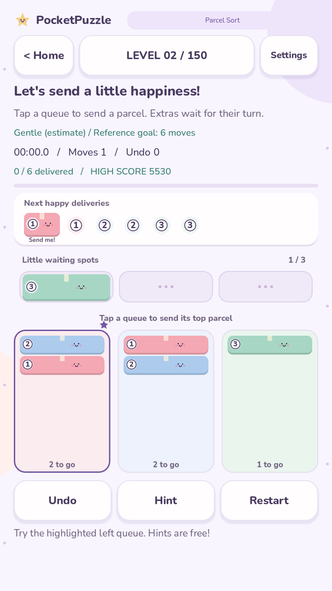
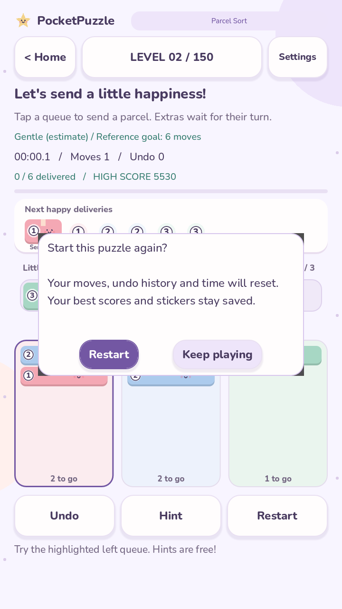
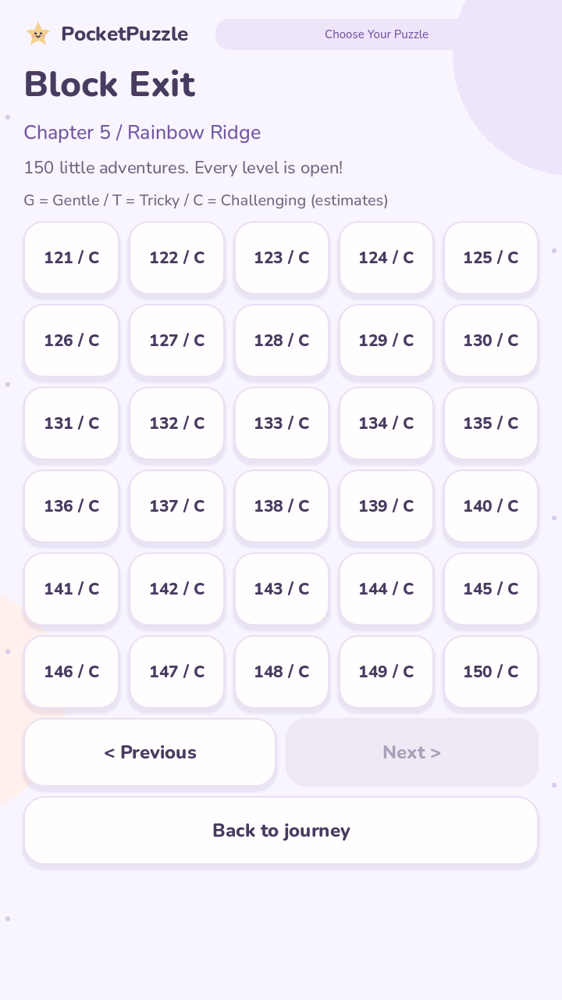

# Smarter Hints & Better Puzzle Progression — build 0.8.0

## A helpful nudge from here

**Hint** now checks the current board. If it is on the catalogue's verified route,
the next move appears immediately. Otherwise, an incremental breadth-first search
looks for a path from the current position to a verified route or a win, then
highlights the first legal move on that path. The hint never moves a piece for
you, changes counters, charges a cost, or awards a result. Thinking time continues.

You can keep playing while a search runs. An accepted move, undo, navigation,
restart prompt or backgrounding cancels it so stale guidance cannot be applied.
Selecting a block alone does not change the puzzle state. When a hint finishes,
it selects the suggested pal and explains its direction.

Search stores at most **2,500 distinct states**, targets **2.5 ms per slice**, and
stops after approximately **180 ms of accumulated computation**. Time checks run
between candidate moves. A candidate operation or OS scheduling can overrun a
slice; these are cooperative budgets, not hard real-time guarantees. The
catalogue's reference replay is prepared once per request and bounded at 2,000
steps; the current catalogue's longest stored solution is 59 moves.

If the budget or reachable search is exhausted, the existing verified backtrack
hint remains available. A limit does not prove that a board is unsolvable. Hints
also do not claim a globally shortest solution. Searching is confined to separate
rule instances; live board state and its full undo history are untouched.

## Pick a comfortable challenge

Each regular or daily puzzle shows **Gentle**, **Tricky** or **Challenging** with an
estimate label. The level chooser uses G, T and C, with an on-screen legend.
These are initial structural estimates, to be refined with human playtesting:

| Game | Gentle | Tricky | Challenging |
| --- | --- | --- | --- |
| Parcel Sort | At most 9 parcels | 10–18 parcels | More than 18 parcels |
| Block Exit | At most 2 pieces and 16 reference moves | At most 5 pieces and 38 reference moves | Remaining puzzles |

Level IDs, puzzle contents, seeds, chapter membership and all existing scores are
retained. The labels do not lock levels or change puzzle rules.

## Find my next puzzle

Use **Find next** at the top of either journey map or **Find my next puzzle** on a
regular result screen. A valid existing regular attempt for that game always
resumes first, even if it is a replay of a previously completed level. This keeps
its moves, time and undo history instead of replacing it with another puzzle.
Without a pending attempt, the earliest unfinished level is selected, including
gaps in earlier chapters. Existing completion flags and scored levels both count
as completed. Daily attempts and the other game's saved attempt remain separate.

When all 150 levels are complete and there is no pending regular attempt, Find
next is disabled; all chapter and level buttons remain available for replays.
Choosing a different level manually retains the established one-pending-regular-
attempt-per-game behavior and replaces that game's current pending attempt.

## An optional move goal

Enable **Move goals** in Settings. It defaults off and is saved for the device,
like the other comfort settings. The game shows a **Reference goal** equal to the
length of a replay-verified winning solution. The result compares total accepted
moves with that target. Moves later undone still count, as in existing scoring.

The goal is not a proven minimum. It is a friendly extra challenge without a
score bonus, sticker requirement, ranking change or attempt limit. Invalid or
incomplete reference paths do not produce goals. Lessons do not display them.

## A safer fresh start

Restarting after any accepted move opens a confirmation card. **Keep playing**
or Android Back cancels without changing the attempt. The active timer pauses
while the card is open and stays paused if the app is backgrounded. **Restart**
resets this attempt's board, moves, undo and time; historical scores, stickers,
daily records and other saved attempts remain. An attempt with no moves restarts
immediately. Settings and navigation continue to save/resume ordinary attempts.

## Validation

Run all project commands from PocketPuzzle. The new suite is:

    godot --headless --path . --script tests/progression.gd

It verifies all 300 difficulty labels and reference paths, forward hints from
alternate boards, state/time limit fallback, seeded deep detours, cancellation,
safe next-level selection, reference-goal persistence, and restart confirmation,
cancellation and reset. Existing gameplay, records, Daily Joy, comfort and journey
checks remain required. Debug builds print hint timing and visited-state counts.

Native GPU captures at 720 × 1280 cover the new UI. Human playtests are still
needed to refine the difficulty estimates and assess whether the targets feel
enjoyable. Headless timing is not a guarantee of device rendering performance.

All seven suites passed on Windows and Linux with Godot 4.7.2. The exported APK
was installed on an OPPO CPH1803 (Android 8.1). Device checks covered saved-attempt
navigation, restart cancellation and confirmation, move-goal persistence across
relaunch, and searched hints in both games. Two small alternate-board searches
reported about 5.4 ms and 1.4 ms of total work, with the largest reported slice
about 2.6 ms. These examples do not establish performance for every board or
phone. A seeded later-level desktop stress case visited 1,232 states. The device's
original scores, settings, stickers and pending games were restored exactly after
the checks.

